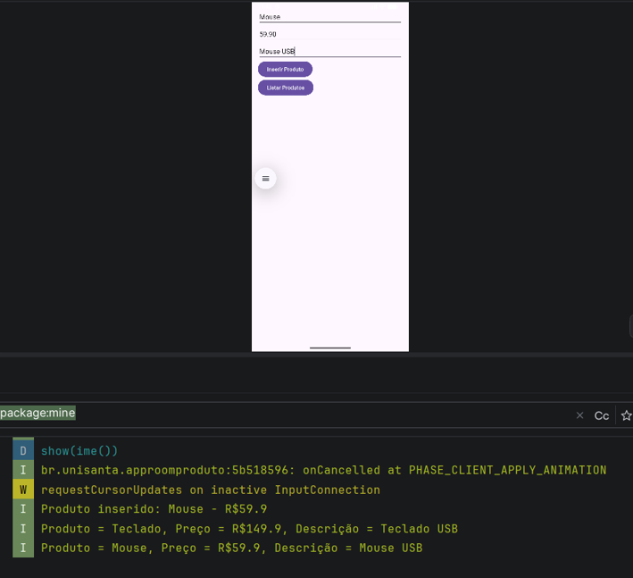
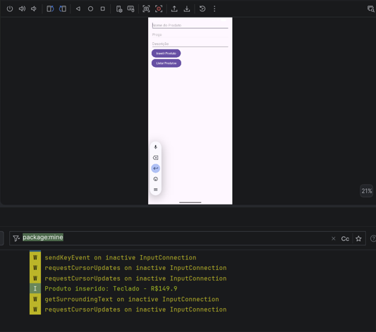
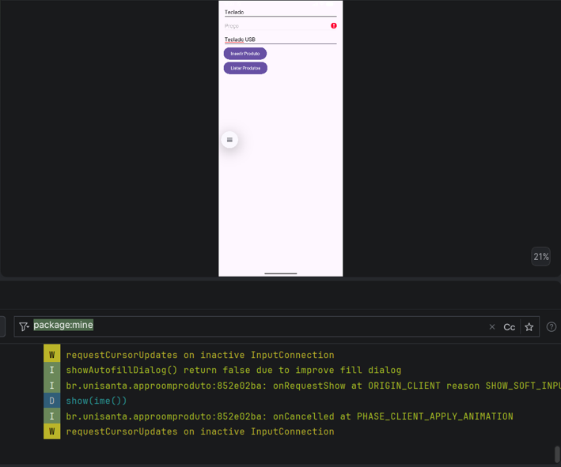
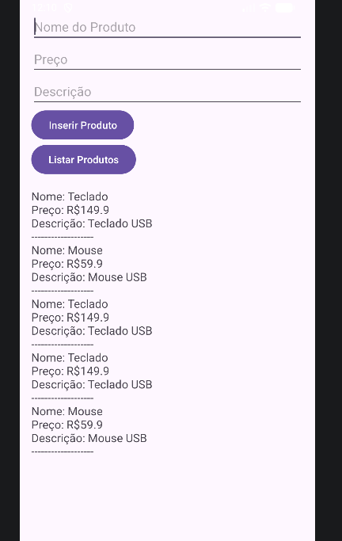
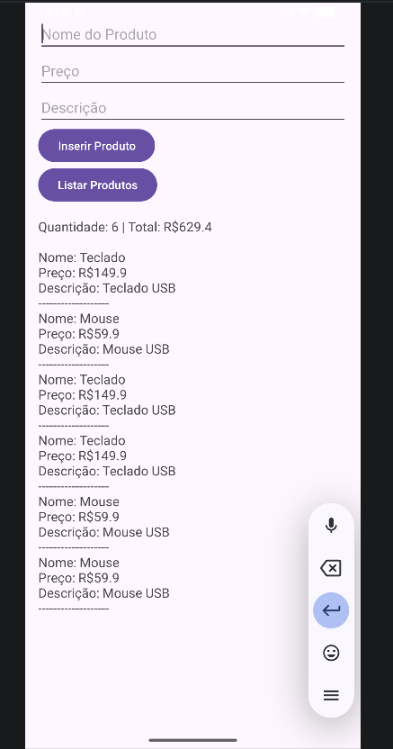
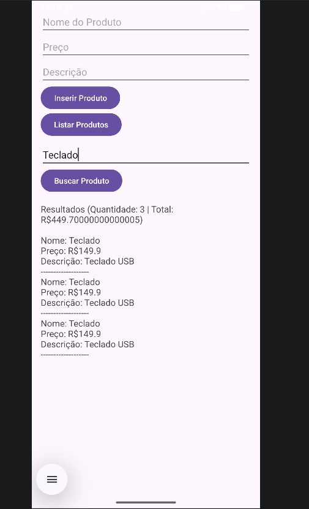
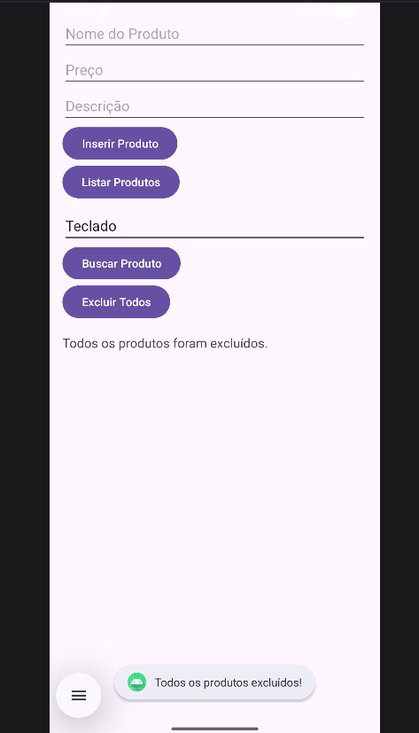
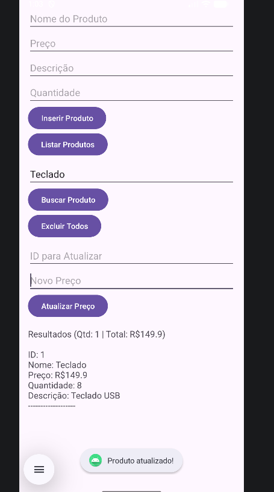
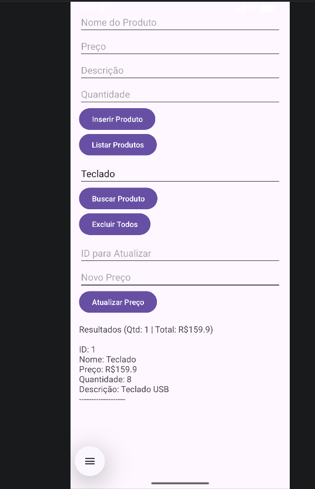

# AppRoomProduto: Cadastro de Produtos com Room SQLite

**Aluno(a):** Giovana Taboada  
**RA:** 230410
**Disciplina:** Desenvolvimento de Aplicativos Móveis  
**Professor(a):** Alessandro  

## Sobre o projeto
Aplicativo Android em Kotlin desenvolvido para a Unisanta que cadastra, lista, busca, atualiza e exclui produtos utilizando persistência local com Room (SQLite), ViewBinding e Corrotinas (`lifecycleScope`).

## Tecnologias
- Kotlin
- Room 2.8.5 (SQLite)
- ViewBinding
- Corrotinas (`lifecycleScope`)

## Prints do app


## Parte A: Complemento prático

### A1. Limpar campos após inserir
**O que foi feito:** Após inserir um produto com sucesso no banco de dados, limpamos o conteúdo dos quatro campos de entrada e retornamos o foco para o campo Nome.  
**Trecho de código:**
```kotlin
binding.editProductName.text.clear()
binding.editProductPrice.text.clear()
binding.editProductDescription.text.clear()
binding.editProductQuantity.text.clear()
binding.editProductName.requestFocus()
```
**Print:** 

### A2. Validação de preço
**O que foi feito:** Impidimos salvar produtos com preço vazio, zero ou negativo, exibindo uma mensagem de erro diretamente no campo de preço.  
**Trecho de código:**
```kotlin
val price = priceText.toDoubleOrNull() ?: 0.0
if (priceText.isEmpty() || price <= 0.0) {
    binding.editProductPrice.error = "Informe um preço válido"
    return@setOnClickListener
}
```
**Print:** 

### A3. Lista na tela
**O que foi feito:** Adicionamos um `ScrollView` contendo um `TextView` abaixo dos botões para exibir a lista de produtos cadastrados diretamente na interface do app.  
**Trecho de código:**
```kotlin
val sb = StringBuilder()
products.forEach {
    sb.append("ID: ${it.id}\nNome: ${it.name}\nPreço: R$${it.price}\nQuantidade: ${it.quantity}\nDescrição: ${it.description ?: "N/A"}\n-------------------\n")
}
binding.textProductList.text = sb.toString()
```
**Print:** 

### A4. Total do estoque
- **O que foi feito:** Exibimos junto à listagem a quantidade total de produtos cadastrados (`products.size`) e a soma dos preços (`products.sumOf { it.price }`).  
**Trecho de código:**
```kotlin
val totalCount = products.size
val totalPrice = products.sumOf { it.price }
sb.append("Quantidade cadastrados: $totalCount | Soma preços: R$$totalPrice\n\n")
```
**Print:** 

### A5. Buscar por nome
**O que foi feito:** Criamos a consulta `@Query("SELECT * FROM product WHERE name LIKE :nome")` no DAO, adicionamos um campo de busca e um botão para filtrar produtos por nomes parecidos.  
**Trecho de código:**
```kotlin
@Query("SELECT * FROM product WHERE name LIKE :nome")
suspend fun buscarPorNome(nome: String): List<Product>

// Na Activity:
val query = binding.editSearchName.text.toString()
val products = productDao.buscarPorNome("%$query%")
```
**Print:** 

### A6. Excluir produtos
**O que foi feito:** Criamos a query `@Query("DELETE FROM product")` no DAO e um botão "Excluir Todos" para limpar todos os registros do banco de dados.  
**Trecho de código:**
```kotlin
@Query("DELETE FROM product")
suspend fun deleteAll()

// Na Activity:
binding.btnExcluirTodos.setOnClickListener {
    lifecycleScope.launch {
        productDao.deleteAll()
        binding.textProductList.text = "Todos os produtos foram excluídos."
    }
}
```
**Print:** 

### A7. Atualizar produto
**O que foi feito:** Criamos uma função com `@Update` e um método `getById` no DAO, permitindo localizar um produto por ID e alterar seu preço na interface.  
**Trecho de código:**
```kotlin
@Update
suspend fun updateProduct(product: Product)

// Na Activity:
val p = productDao.getById(id)
if (p != null) {
    val updated = p.copy(price = newPrice)
    productDao.updateProduct(updated)
}
```
**Print:**  

### A8. Novo campo na tabela
**O que foi feito:** Adicionamos o atributo `quantity: Int` na entidade `Product`, um campo no layout e aumentamos a versão do banco para `2` no `@Database`.  
**Explicação:** Como usamos `.fallbackToDestructiveMigration()`, ao incrementar a versão para 2 sem uma migração customizada, o Room destruiu as tabelas antigas e recriou o banco do zero, apagando os dados anteriores.  
**Trecho de código:**
```kotlin
@Entity
data class Product(
    @PrimaryKey(autoGenerate = true) val id: Int = 0,
    @ColumnInfo(name = "name") val name: String,
    @ColumnInfo(name = "price") val price: Double,
    @ColumnInfo(name = "description") val description: String?,
    @ColumnInfo(name = "quantity") val quantity: Int = 0
)
```
**Print:**  

## Parte B: Questões dissertativas

### B1. O que é persistência de dados? O que aconteceria com os produtos cadastrados se, em vez do Room, eles fossem guardados apenas em uma MutableList dentro da MainActivity?
**Resposta:** Persistência de dados refere-se ao armazenamento de informações de forma duradoura em um meio não volátil (armazenamento interno do dispositivo), permitindo que os dados permaneçam salvos mesmo após fechar o aplicativo ou reiniciar o aparelho. Se utilizássemos apenas uma `MutableList` na `MainActivity`, os dados existiriam exclusivamente na memória RAM e seriam perdidos ao fechar o app ou girar a tela. Com o Room (SQLite), os dados são salvos em arquivo no dispositivo.

### B2. Qual é a diferença entre usar o SQLite diretamente (com SQLiteOpenHelper e comandos SQL manuais) e usar o Room? Cite pelo menos duas vantagens do Room.
**Resposta:** O uso direto do SQLite exige escrever consultas SQL manuais, gerenciar cursores e código repetitivo em subclasses de `SQLiteOpenHelper`. O Room é uma biblioteca de abstração sobre o SQLite. Duas vantagens do Room são: 1) Verificação de consultas em tempo de compilação; 2) Mapeamento automático objeto-relacional (ORM) de tabelas para classes Kotlin.

### B3. Explique o papel de cada uma das três peças do Room: Entity, DAO e Database. Como elas se relacionam no seu projeto?
**Resposta:** 
- **Entity:** Representa a tabela no banco de dados (`Product`).
- **DAO:** Define os comandos e consultas SQL (`ProductDao`).
- **Database:** Classe abstrata que gerencia a conexão e expõe os DAOs (`AppDatabase`).
**Relação:** A `MainActivity` instancia o `AppDatabase`, que fornece o `ProductDao` para manipular os registros da tabela mapeada pela `Entity`.

### B4. Por que o Android não permite acessar o banco de dados na thread principal (UI thread)? O que é um ANR (Application Not Responding)? Como suspend e lifecycleScope.launch resolvem esse problema?
**Resposta:** A thread principal renderiza a interface e responde a toques; operações demoradas nela causam travamentos e o aviso de **ANR (Application Not Responding)**. As corrotinas com `suspend` e `lifecycleScope.launch` executam as operações de banco em segundo plano (thread de I/O), mantendo a interface fluida.

### B5. O que faz o fallbackToDestructiveMigration()? Por que ele é perigoso em um app publicado na Play Store? O que seria uma migração (Migration) de banco de dados?
**Resposta:** O `fallbackToDestructiveMigration()` destrói e recria o banco do zero quando a versão muda sem um script de migração. É perigoso em produção na Play Store pois **apaga permanentemente os dados dos usuários**. Uma `Migration` é um script explícito que atualiza o esquema do banco preservando os dados existentes.

### B6. Qual é a vantagem do ViewBinding em relação ao findViewById? Que tipo de erro ele ajuda a evitar?
**Resposta:** O `ViewBinding` gera referências fortemente tipadas para os componentes de layout em tempo de compilação, eliminando o `findViewById` em tempo de execução e evitando erros de `NullPointerException` e incompatibilidade de tipos.

### B7. No tutorial, o banco é criado dentro da MainActivity. Por que em apps maiores é recomendado criar o banco como Singleton (uma única instância para o app inteiro)? O que poderia acontecer se várias telas criassem cada um o seu banco?
**Resposta:** O padrão **Singleton** garante uma única conexão ativa com o banco, otimizando memória e controlando concorrência. Múltiplas instâncias geram alto consumo de memória, sobrecarga e risco de corrupção de dados por acessos concorrentes ao arquivo SQLite.

### B8. Reflexão pessoal: quais foram as principais dificuldades que você teve neste projeto e como as resolveu? Cite um app real (de comércio, estoque, saúde, escola etc.) em que a persistência local com Room seria útil e explique como você o aplicaria.
**Resposta:** 
- *Dificuldade e solução:* Compatibilidade entre o plugin `kapt` e versões recentes do compilador Kotlin. Resolvido atualizando o Room para a versão `2.8.5`.
- *Exemplo de app real:* Aplicativo de **Controle de Estoque para Mercearias**. O Room seria aplicado para manter o catálogo de produtos e vendas gravados localmente, permitindo ao comerciante operar mesmo sem conexão com a internet.

## Como executar
1. Clone o repositório
2. Abra a pasta do projeto no Android Studio
3. Sincronize o Gradle (Sync Now)
4. Execute o app em um emulador ou dispositivo físico (API 24+)
